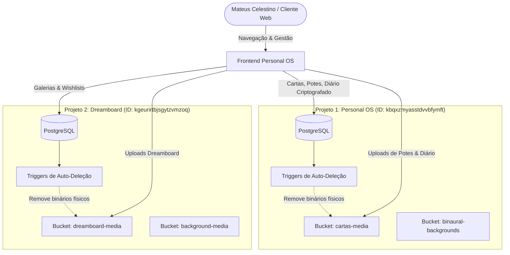

# 🏛️ Arquitetura & Infraestrutura Completa do Backend — M.C.P PERSONAL OS

> **Documento Oficial de Engenharia e Estado do Sistema**  
> *Data de Atualização:* 21 de Agosto de 2026  
> *Autor:* Mateus Celestino / Antigravity AI Engine  
> *Status:* Produção Ativa & Otimizada  

---

## 📑 Sumário Executivo

O ecossistema **M.C.P PERSONAL OS** opera sobre uma arquitetura híbrida de alta performance, combinando **dois projetos isolados no Supabase (PostgreSQL + Cloud Storage + Realtime)** com um frontend estático ultra-leve estilo Apple (dark mode `#000000`, glassmorphism líquido, tipografia SF Mono/Inter e motor de shaders WebGL via OGL).

O sistema prioriza três pilares inegociáveis:
1. **Privacidade Absoluta (Zero-Knowledge):** Todo o diário pessoal é criptografado localmente no navegador antes de qualquer envio ao banco de dados.
2. **Eficiência Extrema de Armazenamento:** Pipeline de mídia ultra-otimizado (compressão sem perda perceptível de qualidade, com redução de mais de 75% da cota total).
3. **Consistência Atômica & Auto-Limpeza:** Nenhum arquivo fantasma é deixado no Storage; deleções na interface removem instantaneamente os registros no banco e os binários físicos na nuvem via gatilhos de banco de dados e APIs do cliente.

---

## 🌐 1. Topologia de Projetos Supabase



### 📋 Mapeamento dos Projetos:

| Projeto | Referência ID | Endpoint URL | Finalidade Primária |
| :--- | :--- | :--- | :--- |
| **Personal OS (binaural)** | `kbqxzmyasstdvvbfymft` | `https://kbqxzmyasstdvvbfymft.supabase.co` | Diário Zero-Knowledge, Potes da Graça/Desgraça, Cartas Visuais, Tags e Categorias. |
| **Dreamboard** | `kgeurirtbjsgytzvmzoq` | `https://kgeurirtbjsgytzvmzoq.supabase.co` | Vitrines Autorais, Notion Shopping Wishlists, Mídias de Galerias e Layouts Bento/Masonry. |

---

## 📜 2. Histórico de Transformações & Incidentes Resolvidos

### A. Destruição do Aplicativo Legado Binaural Pro
* **Contexto:** Existia um aplicativo interno antigo com 13 faixas de áudio binaural em formato `.mp3` de altíssimo peso ocupando mais de 262 MB.
* **Ação Executada:**
  - O bucket `binaural-audios` foi **100% destruído e removido** do Supabase.
  - A tabela `tracks` foi truncada e limpa no banco de dados.
  - O player de áudio do MCP OS foi desacoplado e redirecionado para a nova infraestrutura hospedada em `https://m-c-p-os-binaural-pro.vercel.app/`.

### B. Grande Otimização e Resgate de Cota de Mídia
* **Problema:** A organização estava com 1.095 GB em uso, estourando a cota de 1 GB do plano gratuito.
* **Pipeline de Compressão Implementado:**
  - **Imagens (.png / .jpg / .webp):** Quantização adaptativa de paleta para 256 cores em PNGs, downscaling inteligente (máximo 960px/720p), preservando nitidez visual aos olhos humanos.
  - **Vídeos (.mp4 / .mov):** Transcodificação via FFmpeg H.264 com CRF 30–32, áudio AAC 64k/128k, teto de taxa de quadros (24–30 fps) e `-movflags +faststart` para carregamento instantâneo via streaming no navegador.
* **Resultado Obtido:**
  - `cartas-media`: De 86.84 MB para **47.11 MB** (-45.7%).
  - `dreamboard-media`: De 725.98 MB para **203.72 MB** (-71.9%).
  - **Total Geral da Organização:** Reduzido de **1.095 GB para 270.20 MB (Redução real de 75.3%)**.

---

## 🗄️ 3. Esquemas de Dados Detalhados (PostgreSQL)

### 📌 Projeto 1: Personal OS (`kbqxzmyasstdvvbfymft`)

#### 1. Tabela `diary_entries` (Diário Criptografado)
Armazena as anotações do usuário sem que o banco de dados tenha acesso ao texto original.
* `id` (uuid, PK): Identificador único da anotação.
* `entry_date` (date, NOT NULL): Data da anotação (YYYY-MM-DD) para navegação no calendário.
* `title_preview` (text): Título público ou preview não-sensível da nota.
* `category` / `folder` (text): Slug do livro/pasta a qual a anotação pertence.
* `encrypted_payload` (text, NOT NULL): Conteúdo cifrado em AES-GCM (título, markdown, anexos).
* `iv` (text, NOT NULL): Vetor de Inicialização em Base64 gerado com `crypto.getRandomValues`.
* `salt` (text, NOT NULL): Salt criptográfico em Base64 usado para derivação da chave via PBKDF2.
* `has_media` (boolean): Flag indicando se a anotação contém mídias anexadas.
* `created_at` / `updated_at` (timestamptz): Timestamps de auditoria.

#### 2. Tabela `diary_folders` (Livros e Pastas do Diário)
* `id` (uuid, PK): ID único da pasta.
* `name` (text, NOT NULL): Nome do livro (ex: "Journal", "Projetos", "Espiritual").
* `slug` (text, UNIQUE): Identificador em formato slug.
* `color` (text): Cor hexadecimal associada (ex: `#22c55e`, `#a855f7`, `#3b82f6`).
* `sort_order` (integer): Ordem de exibição na barra lateral.

#### 3. Tabelas `potes_entries` & `potes_media` (Potes da Graça e da Desgraça)
* `potes_entries`:
  - `id` (uuid, PK)
  - `pote_type` (text, CHECK: `'graca'` OU `'desgraca'`)
  - `title` (text, NOT NULL)
  - `description` (text)
  - `has_notes` (boolean)
  - `tags` (text[])
* `potes_media`:
  - `id` (uuid, PK)
  - `pote_entry_id` (uuid, FK -> `potes_entries.id` ON DELETE CASCADE)
  - `pote_type` (text)
  - `file_name` (text)
  - `file_type` (text: `'image'` / `'video'`)
  - `public_url` (text)
  - `sort_order` (integer)

#### 4. Tabelas `cartas_media` & `cartas_tags` (Vitrine de Cartas)
* `cartas_media`:
  - `id` (uuid, PK)
  - `file_name` (text, NOT NULL)
  - `file_type` (text: `'image'` / `'video'`)
  - `public_url` (text, NOT NULL)
  - `tags` (text[])
  - `is_favorite` (boolean, DEFAULT false)
  - `created_at` (timestamptz)

#### 5. Tabela `habits` (Habit Tracker Multi-Engines & Disciplina)
Armazena a rotina e disciplina do usuário com 4 engines interativas (Type Selector, To-Do, Count, Goal Time e Stopwatch), heatmaps de 49 e 343 dias e suporte à sincronização de timers.
* `id` (uuid, PK): Identificador único do hábito.
* `title` (text, NOT NULL): Título ou nome da prática (ex: "Deep Work", "Hidratação", "Proibido Hot").
* `habit_type` (text, DEFAULT `'growth'`): Tipo de hábito:
  - `'growth'`: 🌱 Cultivar (Hábito positivo • Efeito Parallax Neon Green Lights).
  - `'ban'`: 🛑 Destruir (Vício/Eliminação • Efeito Parallax Neon Red Lights).
* `engine_type` (text, DEFAULT `'todo'`): Motor de execução do hábito:
  - `'todo'`: 🔘 To-Do clássico booleano (Feito/Não Feito).
  - `'count'`: 🔢 Count Engine com passos $1/X \to X/X$.
  - `'goal_time'`: ⏱️ Goal Time Engine (Meta de tempo estática + cronômetro ativo).
  - `'progressive_time'`: ⏳ Stopwatch Engine (Cronômetro progressivo livre).
* `target_days` (integer, DEFAULT 40): Meta de consolidação de dias (ex: 21, 40, 66, 90 ou 365 dias).
* `target_count` (integer, DEFAULT 1): Quantidade alvo diária para a **Count Engine** (ex: 5 garrafas).
* `goal_seconds` (integer, DEFAULT 3600): Segundos alvo para a **Goal Time Engine** (ex: 3600s = 1h).
* `complete_days` (jsonb, NOT NULL, DEFAULT `[]`): Array de strings com datas concluídas no padrão `['YYYY-MM-DD']`.
* `daily_progress` (jsonb, DEFAULT `{}`): Progresso diário detalhado: `{ [dateStr]: { count, elapsed_seconds, is_running, completed } }`.
* `habit_view` (boolean, DEFAULT true): Flag de visibilidade do hábito.
* `color` (text, DEFAULT `'#10b981'`): Cor temática (Esmeralda, Ciano, Violeta, Âmbar, Rubi).
* `category` (text, DEFAULT `'Geral'`): Categoria / Tag (ex: Saúde, Foco, Autodomínio).
* `sort_order` (integer, DEFAULT 0): Ordem personalizada de exibição.
* `created_at` / `updated_at` (timestamptz): Timestamps de auditoria.

---

### 📌 Projeto 2: Dreamboard (`kgeurirtbjsgytzvmzoq`)

#### 1. Tabela `galleries` (Coleções e Galerias)
* `id` (uuid, PK)
* `name` (text, NOT NULL): Ex: "MODEL II", "FIAT UNO", "HAIR CUT".
* `slug` (text, UNIQUE): Ex: "model-ii".
* `layout_type` (text): `'masonry'`, `'bento'`, `'horizon'`, `'showcase'`.
* `description` (text)
* `is_notion_wishlist` (boolean, DEFAULT false)
* `sort_order` (integer)

#### 2. Tabela `media_items` (Itens de Mídia das Galerias)
* `id` (uuid, PK)
* `gallery_id` (uuid, FK -> `galleries.id` ON DELETE CASCADE)
* `storage_path` (text, NOT NULL): Caminho exato no bucket `dreamboard-media`.
* `public_url` (text, NOT NULL)
* `filename` (text)
* `media_type` (text: `'image'` / `'video'`)
* `file_size_bytes` (bigint)
* `sort_order` (integer)

---

## 🛡️ 4. Sistema de Auto-Deleção e Limpeza Permanente (Anti-Ghost Files)

Para assegurar que **nunca mais existam arquivos órfãos no Storage**, foi construída uma arquitetura de **Dupla Proteção**:

### Camada 1: Client-Side (JavaScript / Admin UI)
Antes de excluir qualquer registro no banco, o frontend executa chamadas diretas ao Storage API:
* **Admin / Cartas:** `client.storage.from('cartas-media').remove([paths])`
* **Admin / Potes:** Varre `potes_media` e remove todos os arquivos atrelados ao pote.
* **Admin / Dreamboard:** Varre `media_items` e remove recursivamente os caminhos da galeria.
* **Diário Pessoal:** Na exclusão de anotações, faz o parse de URLs contidas no markdown (`diary-uploads/...`) e remove os binários físicos.

### Camada 2: Backend Database Triggers (PostgreSQL Nativo)
Gatilhos instalados em nível de banco de dados executados `AFTER DELETE` com privilégios `SECURITY DEFINER` e liberação de bypass `storage.allow_delete_query`:

```sql
-- Exemplo de Trigger implementado no PostgreSQL:
CREATE OR REPLACE FUNCTION trig_delete_cartas_media_storage()
RETURNS TRIGGER
LANGUAGE plpgsql
SECURITY DEFINER
AS $$
BEGIN
    SET LOCAL storage.allow_delete_query = 'true';
    DELETE FROM storage.objects 
    WHERE bucket_id = 'cartas-media' 
      AND (name = OLD.file_name OR name = split_part(OLD.public_url, 'cartas-media/', 2));
    RETURN OLD;
END;
$$;
```

---

## 🔐 5. Protocolo de Criptografia Zero-Knowledge do Diário

O Diário Pessoal segue o modelo de criptografia em repouso ponta a ponta no navegador do cliente:

```
[ Senha Mestre do Usuário ]
          │
          ▼  (PBKDF2-SHA256, 100.000 iterações + Salt)
[ Chave AES-GCM de 256 bits ]
          │
          ▼  (Criptografia Local com IV Único)
[ Ciphertext Criptografado ] ──► [ Armazenado no Supabase PostgreSQL ]
```

* **Vantagem:** Mesmo com acesso irrestrito ao banco de dados ou painel do Supabase, ninguém consegue ler o conteúdo das anotações nem identificar os anexos sem a senha mestra.

---

## 🎨 6. Ecossistema Frontend & Motores Gráficos

* **Motor WebGL (OGL):** Arquivo `js/webgl-backgrounds.js` com 21 shaders de alta fidelidade (`SoftAurora`, `PlasmaWave`, `Strands`, `SideRays`, `Ferrofluid`, `Dither`, `DarkVeil`, `WebThreads`, `Topography`, `Balatro`, `FaultyTerminal`, `MorphSlider`, `Antigravity`, `Aurora`, `LetterGlitch`, `Plasma`, `Hyperspeed`, `Prism`, `PrismaticBurst`, `Lightning`, `EvilEye`).
* **Design System Liquid Glass:** Modais transparentes calibrados com `backdrop-blur-md` e gradientes sutis em `index.html` e `admin.html` para permitir que o shader WebGL ativo brilhe através de todos os painéis.
* **Compatibilidade Universal de Áudio:** Módulo de gravação de áudio com fallback automático de codecs (`audio/mp4`, `audio/webm`, `audio/aac`) para suporte impecável no Safari (iOS/macOS) e Chrome/Android.

---

## 📁 7. Estrutura de Arquivos do Repositório

* [`admin.html`](file:///Users/mcp/Downloads/UPDATE-PERSONAL%20OS/m-c-p---os-personal-os/admin.html) — Painel Administrativo de mídias, galerias, tags, potes e auto-exclusão no Storage.
* [`diary.html`](file:///Users/mcp/Downloads/UPDATE-PERSONAL%20OS/m-c-p---os-personal-os/diary.html) — Diário Pessoal com criptografia AES-GCM, calendário por cores de livro e gravador de voz.
* [`index.html`](file:///Users/mcp/Downloads/UPDATE-PERSONAL%20OS/m-c-p---os-personal-os/index.html) — Vitrine principal com Potes da Graça/Desgraça, galerias por tag e visualizador Liquid Glass.
* [`gemini.md`](file:///Users/mcp/Downloads/UPDATE-PERSONAL%20OS/m-c-p---os-personal-os/gemini.md) — Constituição e invariantes arquiteturais do sistema.
* [`structure/backend_infrastructure.md`](file:///Users/mcp/Downloads/UPDATE-PERSONAL%20OS/m-c-p---os-personal-os/structure/backend_infrastructure.md) — Este relatório mestre de arquitetura e infraestrutura de backend.
